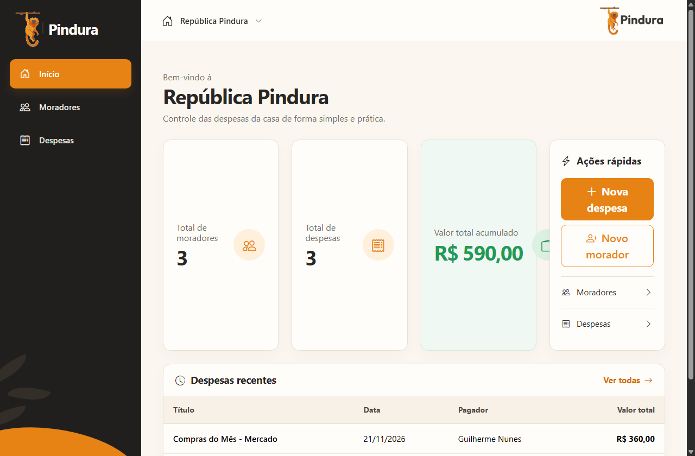
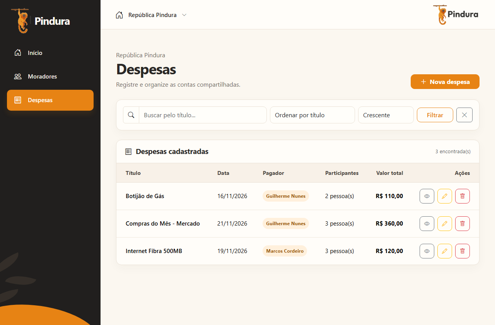
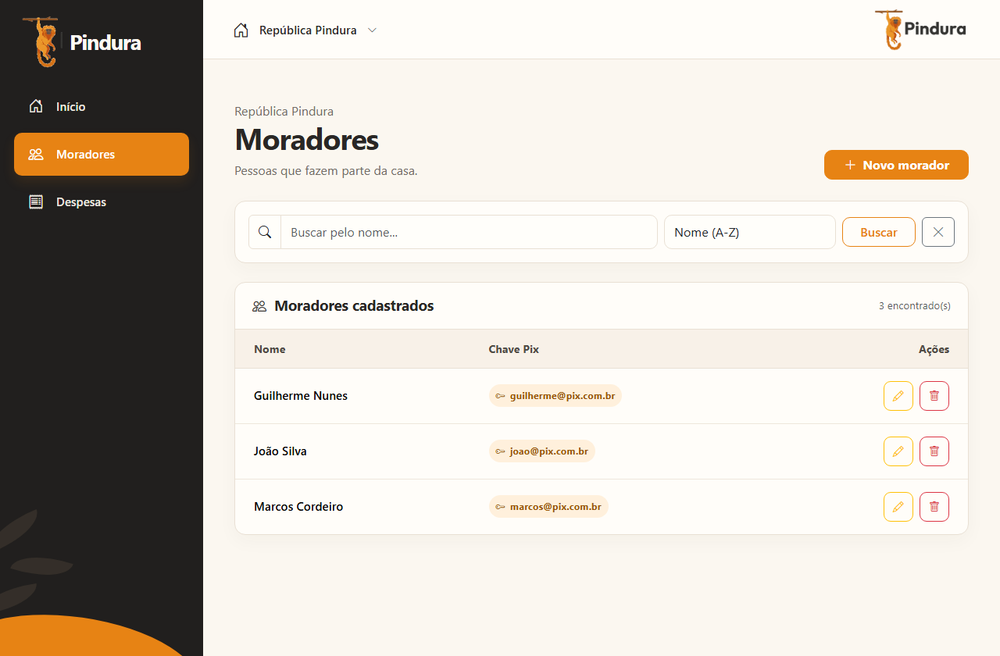
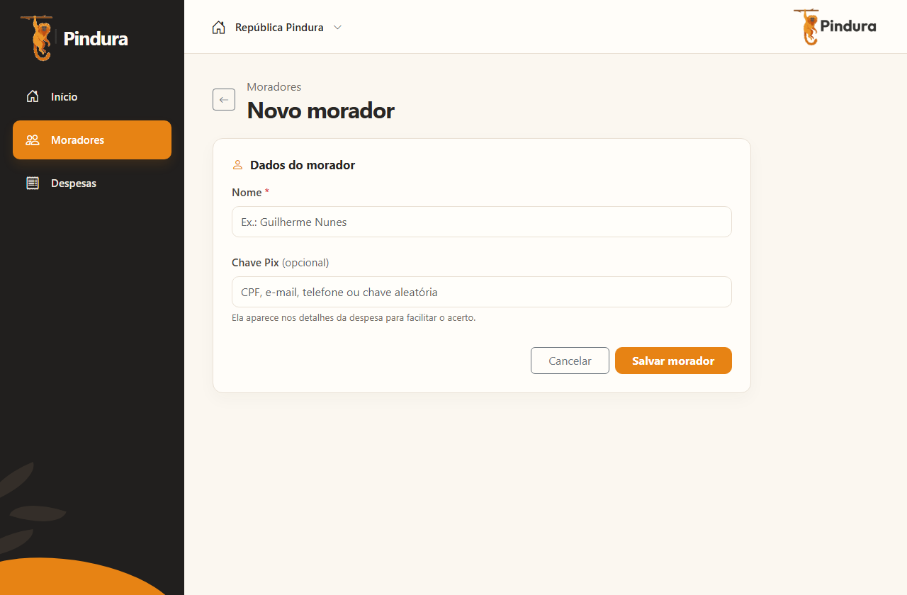
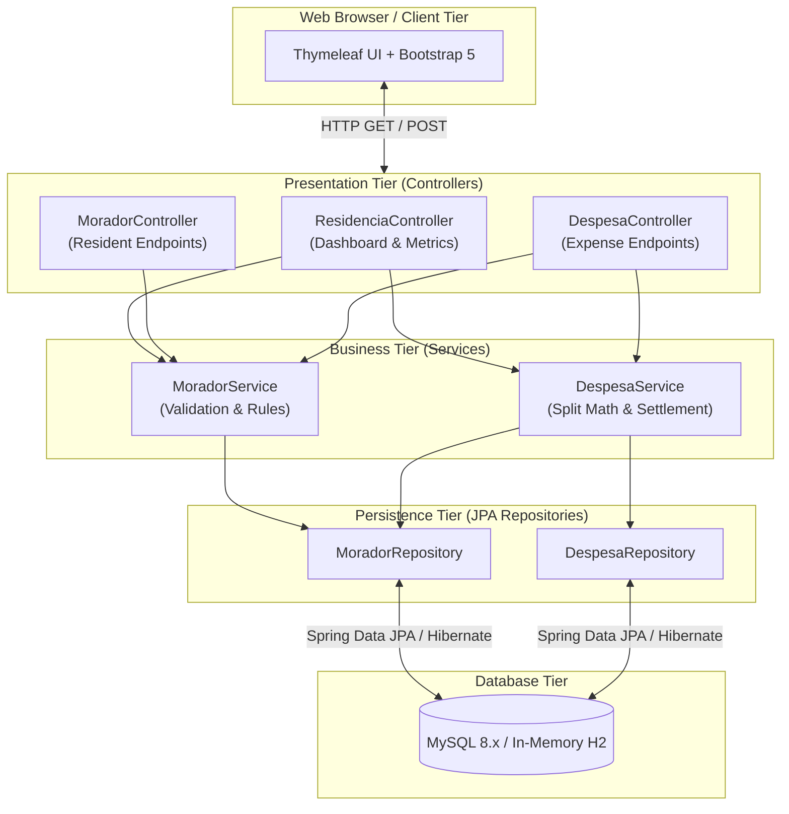

<div align="center">

# 🐒 Pindura — Smart Shared Expense Management

<p align="center">
  <strong>Full-stack web application designed for transparent expense splitting and balance settlement in shared student housings and co-living spaces.</strong>
</p>

<p align="center">
  <a href="README.md">🇧🇷 Português</a> •
  <a href="README.en.md">🇺🇸 English</a>
</p>

[](https://www.oracle.com/java/)
[](https://spring.io/projects/spring-boot)
[](https://www.thymeleaf.org/)
[](https://getbootstrap.com/)
[](https://www.mysql.com/)
[](https://www.h2database.com/)
[]()

</div>

---

## 📌 Executive Summary & Business Problem

Living in shared housings and student accommodations frequently leads to interpersonal friction around bill tracking, lost receipts, and awkward debt reminders between housemates.

**Pindura** was architected to eliminate financial ambiguity: a centralized, high-usability web platform that tracks residents, registers utility bills and shared expenses, automates mathematical debt division, and provides instant Pix payment key lookups for seamless debt settlement.

---

## 📸 Visual Showcase

Crafted with an original visual identity featuring warm orange tones and a custom **Golden Lion Tamarin** mascot, offering an intuitive and responsive user experience.

| Main Dashboard | Expense & Settlement Management |
|:---:|:---:|
|  |  |

| Resident Directory | Resident Registration Form |
|:---:|:---:|
|  |  |

---

## 💡 Core Capabilities

- **Real-time Analytical Dashboard**: Aggregated KPIs displaying total occupants, registered expenses count, and cumulative financial metrics.
- **Fair Share Calculation Engine**: Automated mathematical split computation isolated in the service layer using strict decimal precision (`RoundingMode.HALF_UP`).
- **Debt Settlement Matrix**: Automatic exclusion of the payer's own quota and itemized calculation of owed amounts per participant, showing the creditor's Pix key.
- **Enterprise CRUD Operations**: Robust persistence layer with bidirectional entity mapping, defensive validation at both UI and domain layers.
- **Dynamic Search & Multi-criteria Sorting**: Instant filtering by resident name or bill title with ASC/DESC ordering on names, values, or dates.
- **Dual Database Strategy**:
  - **MySQL 8.x** for production-grade ACID relational persistence.
  - **In-memory H2** equipped with a `dev` profile for instant evaluation with pre-seeded demo records without external prerequisites.

---

## 🏗️ Architecture & Software Engineering

Developed under classic enterprise Java principles, adhering to a strict **Layered Architecture** with Separation of Concerns (SoC) and clean domain boundaries:



---

## 🛠️ Tech Stack & Tooling

| Technology | Purpose |
|---|---|
| **Java 21 LTS** | Core backend language with strong typing and modern performance. |
| **Spring Boot 3.3.4** | Application framework (Spring Web, Spring Data JPA, DevTools). |
| **Thymeleaf** | Modern server-side template engine. |
| **Bootstrap 5 & Icons** | Responsive UI styling with custom design tokens. |
| **Hibernate / JPA** | ORM for clean entity lifecycle and relational mapping. |
| **Jakarta Validation** | Declarative data integrity annotations (`@NotBlank`, `@DecimalMin`, `@NotEmpty`). |
| **MySQL 8.x / H2** | Relational transactional databases. |
| **Maven Wrapper** | Deterministic dependency build and lifecycle management. |

---

## 🚀 Quickstart Guide

### Prerequisites
- **Java JDK 21+** configured in environment `PATH`.
- Git.

### Option 1: Instant Evaluation (Zero Setup — In-Memory H2)

Run the application locally in under 60 seconds with no database configuration needed:

```bash
# 1. Clone the repository
git clone https://github.com/GuilhermeHenriqueNunes/Pindura.git
cd Pindura

# 2. Run with the Maven Wrapper using the 'dev' profile (Windows)
.\mvnw.cmd spring-boot:run -Dspring-boot.run.profiles=dev

# Linux / macOS:
# ./mvnw spring-boot:run -Dspring-boot.run.profiles=dev
```

Open your browser at: **`http://localhost:8080`**  
*(The `dev` profile automatically seeds sample residents and shared bills).*

---

### Option 2: Running with MySQL

1. Create the database:
```sql
CREATE DATABASE pindura_db;
```

2. Pass connection properties through environment variables:
```bash
# Windows PowerShell
$env:DB_URL="jdbc:mysql://localhost:3306/pindura_db"
$env:DB_USERNAME="your_user"
$env:DB_PASSWORD="your_password"
.\mvnw.cmd spring-boot:run
```

---

## 🧪 Testing & Verification

Run the automated test suite and Maven build checks:

```bash
.\mvnw.cmd test
```

---

## 👥 Authors & Collaborators

Crafted in collaboration by:

<table align="center">
  <tr>
    <td align="center">
      <a href="https://github.com/GuilhermeHenriqueNunes">
        <br />
        <sub><b>Guilherme Nunes</b></sub>
      </a><br />
      <a href="https://www.linkedin.com/in/guilherme-henriquesilva-nunes/" title="LinkedIn">
        
      </a>
      <a href="https://github.com/GuilhermeHenriqueNunes" title="GitHub">
        
      </a>
    </td>
    <td align="center">
      <a href="https://github.com/cordeiromarcos">
        <br />
        <sub><b>Marcos Cordeiro</b></sub>
      </a><br />
      <a href="https://github.com/cordeiromarcos" title="GitHub">
        
      </a>
    </td>
  </tr>
</table>

---

## 📄 License

This project is licensed under the [MIT License](LICENSE).
