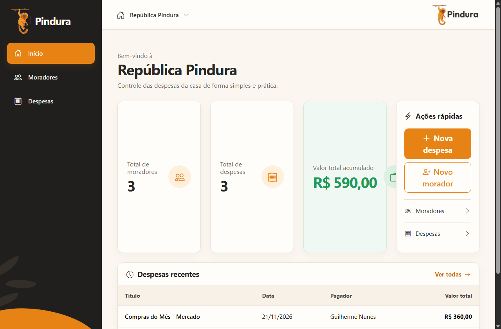
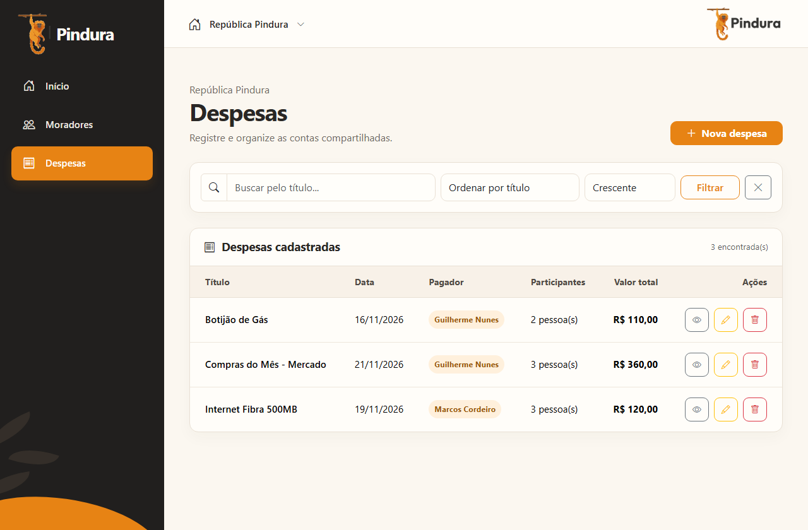
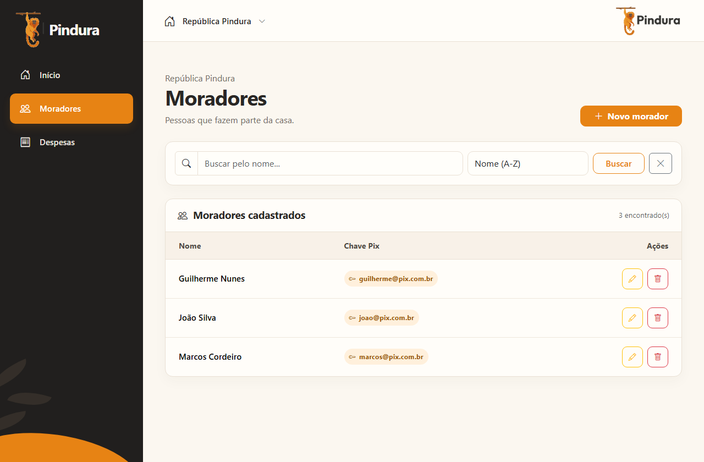
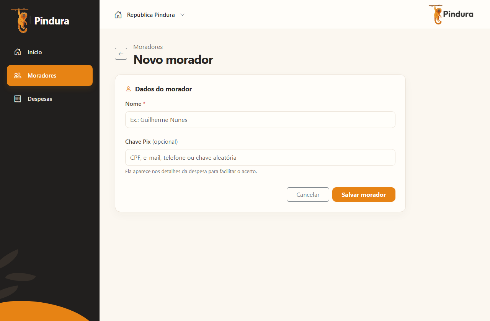
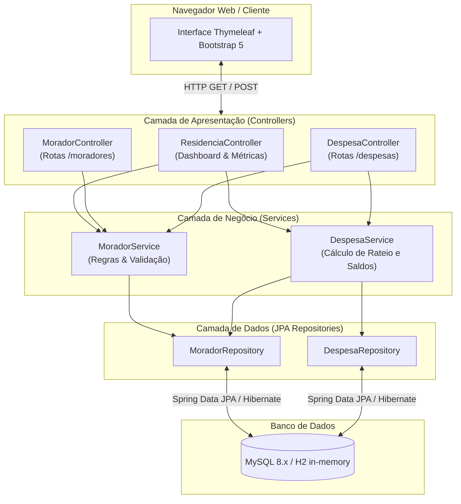

<div align="center">

# 🐒 Pindura — Gestão Inteligente de Despesas Compartilhadas

<p align="center">
  <strong>Solução web full-stack para rateio transparente de despesas em repúblicas e moradias compartilhadas.</strong>
</p>

<p align="center">
  <a href="README.md">🇧🇷 Português</a> •
  <a href="README.en.md">🇺🇸 English</a>
</p>

[](https://www.oracle.com/java/)
[](https://spring.io/projects/spring-boot)
[](https://www.thymeleaf.org/)
[](https://getbootstrap.com/)
[](https://www.mysql.com/)
[](https://www.h2database.com/)
[]()

</div>

---

## 📌 Visão Geral do Projeto

Viver em moradias compartilhadas e repúblicas estudantis frequentemente resulta em atrito na prestação de contas, desorganização em notas fiscais e cobranças desconfortáveis entre amigos. 

O **Pindura** foi projetado para eliminar essa complexidade: uma plataforma centralizada e de alta usabilidade que gerencia moradores, registra despesas com seus respectivos pagadores e participantes, calcula de forma automatizada o rateio proporcional das contas e exibe a chave Pix para quitação instantânea dos saldos devedores.

---

## 📸 Demonstração Visual da Interface

A aplicação foi desenhada com identidade visual autoral em tons de laranja aconchegante e mascote do **mico-leão-dourado**, oferecendo experiência intuitiva e responsiva.

| Painel Principal (Dashboard) | Gestão de Despesas e Rateios |
|:---:|:---:|
|  |  |

| Gestão de Moradores | Formulário de Morador |
|:---:|:---:|
|  |  |

---

## 💡 Principais Funcionalidades

- **Dashboard Resumo**: Métricas consolidadas em tempo real com total de moradores, quantidade de despesas cadastradas e saldo financeiro global.
- **Divisão Matemática de Contas**: Algoritmo no Service Layer que calcula a cota individual de cada participante com precisão decimal (`RoundingMode.HALF_UP`).
- **Resolução de Saldos (Quem deve a Quem)**: Isolamento do pagador e cálculo exato de débitos para cada participante, associando a chave Pix do credor.
- **CRUD Completo & Robusto**: Criação, leitura, atualização e remoção de moradores e despesas com validação defensiva em dois níveis (Front-end e Back-end).
- **Filtros Dinâmicos e Ordenação**: Busca por nome ou título e ordenação ascendente/descendente (por nome, valor ou data).
- **Duplo Suporte a Banco de Dados**:
  - **MySQL** para ambiente de homologação/produção com persistência relacional.
  - **H2 in-memory** integrado com profile `dev` para inicialização imediata e testes sem dependências externas.

---

## 🏗️ Arquitetura e Engenharia de Software

O projeto adota os padrões consolidados da engenharia corporativa Java, seguindo a arquitetura em camadas (**Layered Architecture**) com estrita separação de responsabilidades (SoC) e princípios SOLID:



### 🧩 Modelo Entidade-Relacionamento

- **Morador (1) — (N) Despesa (Pagador)**: Uma despesa possui exatamente 1 morador responsável pelo pagamento.
- **Morador (N) — (M) Despesa (Participantes)**: Uma despesa é rateada entre múltiplos participantes através da tabela associativa `despesa_participantes`.

---

## 🛠️ Tecnologias Utilizadas

| Tecnologia | Finalidade no Ecossistema |
|---|---|
| **Java 21 LTS** | Linguagem robusta com tipagem estática e alta performance. |
| **Spring Boot 3.3.4** | Framework base (Spring Web, Spring Data JPA, DevTools). |
| **Thymeleaf** | Motor de templates para renderização server-side moderna. |
| **Bootstrap 5 & Icons** | Framework visual responsivo com CSS customizado. |
| **Hibernate / JPA** | ORM para mapeamento relacional de objetos. |
| **Jakarta Validation** | Validações declarativas (`@NotBlank`, `@DecimalMin`, `@NotEmpty`). |
| **MySQL 8.x / H2** | Armazenamento de dados transacional e flexível. |
| **Maven** | Gerenciamento de ciclo de vida e dependências. |

---

## 🚀 Como Executar Localmente

### Pré-requisitos
- **Java JDK 21+** instalado e configurado no `PATH`.
- Git instalado.

### Opção 1: Execução Imediata (Zero Configuração — Banco H2 em Memória)

Para testar e avaliar a aplicação em menos de 1 minuto sem precisar de MySQL instalado:

```bash
# 1. Clone o repositório
git clone https://github.com/GuilhermeHenriqueNunes/Pindura.git
cd Pindura

# 2. Execute via Maven Wrapper com o profile 'dev' (Windows)
.\mvnw.cmd spring-boot:run -Dspring-boot.run.profiles=dev

# No Linux / macOS:
# ./mvnw spring-boot:run -Dspring-boot.run.profiles=dev
```

Acesse: **`http://localhost:8080`**  
*(O profile `dev` já carrega dados de exemplo automaticamente para você testar todas as telas).*

---

### Opção 2: Execução com MySQL

1. Crie o banco de dados no MySQL:
```sql
CREATE DATABASE pindura_db;
```

2. Configure as variáveis de ambiente (ou execute diretamente com os parâmetros):
```bash
# Windows PowerShell
$env:DB_URL="jdbc:mysql://localhost:3306/pindura_db"
$env:DB_USERNAME="seu_usuario"
$env:DB_PASSWORD="sua_senha"
.\mvnw.cmd spring-boot:run
```

---

## 🧪 Estratégia de Testes

Para executar o pipeline de compilação e verificação de testes automatizados:

```bash
.\mvnw.cmd test
```

---

## 👨‍💻 Desenvolvedor

<table align="center">
  <tr>
    <td align="center">
      <a href="https://github.com/GuilhermeHenriqueNunes">
        <br />
        <sub><b>Guilherme Nunes</b></sub>
      </a><br />
      <a href="https://www.linkedin.com/in/guilherme-henriquesilva-nunes/" title="LinkedIn">
        
      </a>
      <a href="https://github.com/GuilhermeHenriqueNunes" title="GitHub">
        
      </a>
    </td>
  </tr>
</table>

---

## 📄 Licença

Este projeto está sob a licença [MIT](LICENSE).
